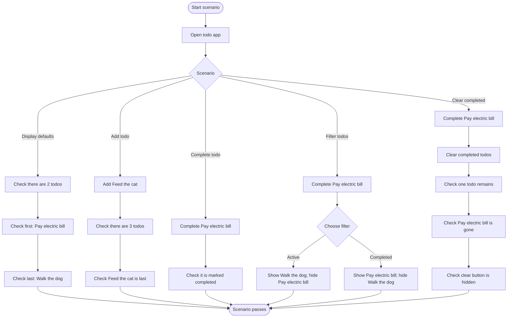
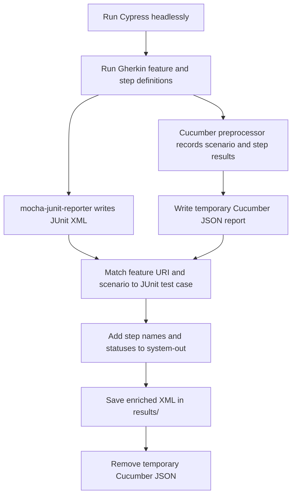

# Cypress Cucumber Tests

This project runs Cypress end-to-end tests written in Gherkin and produces JUnit
XML reports that include the Cucumber steps and their results.

## Requirements

- Node.js and npm
- Dependencies installed from `package-lock.json`

## Setup

Install the project dependencies:

```bash
npm install
```

The Cypress Cucumber preprocessor connects `.feature` files to their step
definitions. The esbuild preprocessor bundles those definitions for Cypress,
and `mocha-junit-reporter` writes test results as JUnit XML.

The example feature is
[`cypress/e2e/1-getting-started/todo.feature`](cypress/e2e/1-getting-started/todo.feature).
Its step definitions are in
[`cypress/e2e/1-getting-started/todo.js`](cypress/e2e/1-getting-started/todo.js).

## Running the tests

Run the tests headlessly and generate reports:

```bash
npm run cypress:headless
```

To run only the todo feature:

```bash
npm run cypress:headless -- --spec "cypress/e2e/1-getting-started/todo.feature"
```

To open the Cypress interactive runner:

```bash
npm run cypress:gui
```

Step-enriched JUnit reports are produced by the headless run.

## Reports

Headless runs write JUnit reports to `results/test-results-[hash].xml`.
Each scenario remains a JUnit test case. Its `<system-out>` element contains
the Cucumber steps and each step's status, for example:

```xml
<system-out>Cucumber steps:
Given I open the todo app [passed]
Then I should see 2 todo items [passed]</system-out>
```

The Cucumber preprocessor temporarily writes
`results/cucumber-report.json`. After the run, the report integration matches
its scenarios to the JUnit test cases, adds the steps, and removes the
temporary JSON file. The XML report keeps the scenario's pass/fail result;
step details are additional output.

## Todo scenarios

The diagram below summarizes the six scenarios in the
[`todo.feature`](cypress/e2e/1-getting-started/todo.feature) file. Each scenario
starts with a fresh visit to the todo app.



## How report generation works



The report handling is configured in
[`cypress.config.ts`](cypress.config.ts) and implemented in
[`cypress/report-junit-steps.js`](cypress/report-junit-steps.js).
